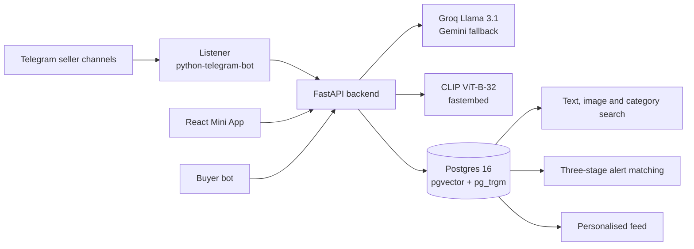

# Index Gebeya

A Telegram-native marketplace aggregator for the Ethiopian market. It watches
seller channels, turns free-form posts into structured catalog items with LLM
extraction and image embeddings, and serves search, alerts and a personalised
feed through a Telegram Mini App and a companion bot.

Built as a real product, not a demo: ingestion, catalog, search, alerts,
reviews, payments, an operations console, and a test suite around the backend
behaviour.

## Architecture



The listener is a separate process from the API. It owns the Telegram
connection, pulls posts and photos, and posts them to the ingestion endpoint.
The API does the extraction, classification, embedding and persistence. The bot
and Mini App read from the same API.

## Stack

| Layer | What is used |
|---|---|
| API | FastAPI, SQLAlchemy, Pydantic, Uvicorn |
| Database | PostgreSQL 16 with `pgvector` and `pg_trgm` |
| Extraction | Groq (Llama 3.1 8B) with Google Gemini 2.0 Flash Lite as fallback |
| Vision | CLIP ViT-B-32 embeddings through `fastembed`, stored in Postgres |
| Bot / ingestion | `python-telegram-bot` (channel monitoring, buyer bot, payments) |
| Frontend | React 19, Vite, Tailwind CSS 4, React Router |
| Ops | `sqladmin`, an internal ops console, Caddy reverse proxy |
| Packaging | Docker Compose (db, api, listener, frontend) |

## What it does

- **Ingestion.** Monitors seller channels, deduplicates posts, downloads photo
  albums, and survives restarts with a retry/dead-letter queue.
- **AI extraction.** Pulls title, price, category, specs and contact details
  out of unstructured captions. Provider fallback and output guardrails live in
  `backend/ai_engine/`.
- **Visual search.** Every item gets a CLIP embedding, so buyers can search by
  image and find visually similar listings.
- **Alerts.** Buyers define keyword, category and price filters; a three-stage
  matcher decides which new items notify which buyer.
- **Trust.** Seller reviews, a 0-5 trust score, and moderation/ban primitives.
- **Monetisation.** Channel boosts, buyer subscriptions, and Telegram Stars
  payments with reconciliation and audit trails.
- **Ops console.** Health, audit, settings, payment reconciliation and tooling
  behind a separate admin session.

## Layout

| Path | Purpose |
|---|---|
| `backend/` | FastAPI app, routes, services, models, AI engine, tests |
| `listener/` | Telegram ingestion and buyer-bot process |
| `frontend/` | React Mini App and web storefront |
| `deploy/` | Caddy configuration |
| `docs/` | Behaviour specs, ADRs, and implementation plans |
| `CONTEXT.md` | Domain model and ubiquitous language |

## Quick start

Requirements: Docker and Docker Compose.

```bash
cp .env.example .env
# Fill in DB_*, GROQ_API_KEY, GOOGLE_API_KEY, TELEGRAM_BOT_TOKEN,
# and ADMIN_SECRET_KEY. The example file documents each variable.
docker compose up -d --build
```

Once the stack is up:

- API docs: <http://localhost:8000/docs>
- Mini App: <http://localhost:3001>
- Postgres is exposed on `5433` for local inspection.

The API creates its schema from the SQLAlchemy metadata on startup and enables
the `vector` and `pg_trgm` extensions itself. There is no separate migration
step.

## Tests

Backend tests expect a running Postgres with the test database configured in
`backend/tests/conftest.py` (`suq_test_db` on `localhost:5433`) and a `.env`
with the database credentials.

```bash
pytest backend/tests -q
```

Frontend tests use Vitest and Testing Library:

```bash
cd frontend
npm ci
npm test
```

## Design notes

- **Domain language first.** `CONTEXT.md` is the glossary; behaviour documents
  in `docs/behaviors/` describe rules from the buyer's or seller's point of
  view, without database or endpoint jargon.
- **Local embeddings.** Image vectors are produced in-process with fastembed.
  There is no external vector service to operate.
- **Guardrails before persistence.** LLM output is validated before it becomes
  a catalog row; malformed extraction is rejected rather than stored.
- **Raw HTTP to Telegram from the backend.** The API does not depend on
  `python-telegram-bot`; it calls the Bot API with `httpx`. The listener owns
  the long-lived bot connection.

## Status and limitations

This is a production-shaped codebase for one market and one taxonomy (the Jiji
Ethiopia category tree), not a general-purpose marketplace kit. Running it
requires Telegram API access and LLM provider keys. The development defaults
for CORS and admin secrets are permissive and must be tightened before a public
deployment. Media is stored on a Docker volume rather than object storage.

## License

MIT. See `LICENSE`.
